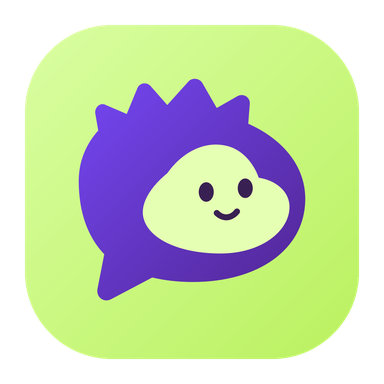

# Everyday Chat · Secure Collab

| Everyday Chat | Secure Collab |
| --- | --- |
|  |  |
| 1:1·단체 대화 화면 | 팀 워크스페이스·채널 화면 |

두 앱은 **로컬 미리보기**로 실행됩니다. 기기 간 메시지 전송은 아직 연결되지 않았습니다.

## 사진과 움직이는 이모티콘

채팅창에서 **＋ → 사진·동영상·파일**을 눌러 첨부를 고릅니다. **＋ → 캐릭터 이모티콘**에서 원하는 이모티콘을 누르면 현재 대화 화면에 표시됩니다.

모리·루루·보보·토토·누리·두리의 단독 표현 120종과 함께 등장하는 표현 12종이 있습니다. 아래는 캐릭터 원화이며, 한글 말풍선과 움직임은 앱에서 확인할 수 있습니다.

<p>
  
  
  
  
  
  
</p>

## 소스에서 실행

현재 [GitHub Releases](https://github.com/charater1024-lang/private-chat-platform/releases)에 설치 파일은 없습니다. Flutter 3.47.2(Dart 3.13.2 포함)와 실행할 플랫폼의 개발 도구가 필요합니다.

| 플랫폼 | 준비할 도구 | 실행 명령 |
| --- | --- | --- |
| Windows | Visual Studio의 **C++를 사용한 데스크톱 개발**, CMake, Windows SDK | `flutter run -d windows` |
| Linux | Clang, CMake, Ninja, pkg-config, GTK 3 개발 패키지 | `flutter run -d linux` |
| Android | Android SDK와 에뮬레이터 또는 연결된 기기 | `flutter run -d <기기-ID>` |
| iOS | macOS, Xcode, iOS 시뮬레이터 | `flutter run -d <기기-ID>` |

[Flutter 플랫폼별 설정](https://docs.flutter.dev/install)

```sh
git clone https://github.com/charater1024-lang/private-chat-platform.git
cd private-chat-platform
flutter doctor -v
flutter pub get
cd apps/everyday_chat
flutter devices
```

업무용을 실행하려면 마지막 앱 폴더로 `apps/secure_collab`을 선택합니다. 앱 폴더에서 표의 명령을 실행하세요. 모바일은 `flutter devices` 출력의 기기 ID를 사용합니다.

---

## English

**Everyday Chat** previews direct and group conversations. **Secure Collab** previews team workspaces and channels. Both run locally without cross-device messaging.

Use **＋ → Photo, video, or file** to select an attachment, or **＋ → Character stickers** to add one of 132 animated stickers. The images above show the character artwork. The app adds motion and Korean captions.

Install Flutter 3.47.2 and the platform tools listed above. Clone this repository, run `flutter pub get` from its root, then run `flutter devices` and `flutter run -d <device-id>` from `apps/everyday_chat` or `apps/secure_collab`. There are currently no installers on the GitHub Releases page.
